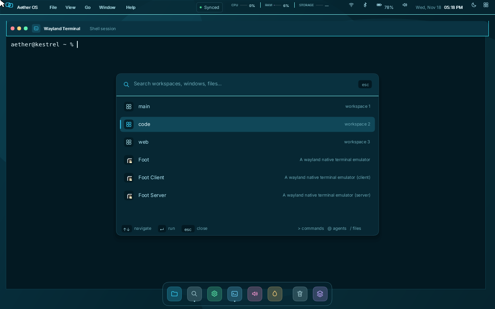
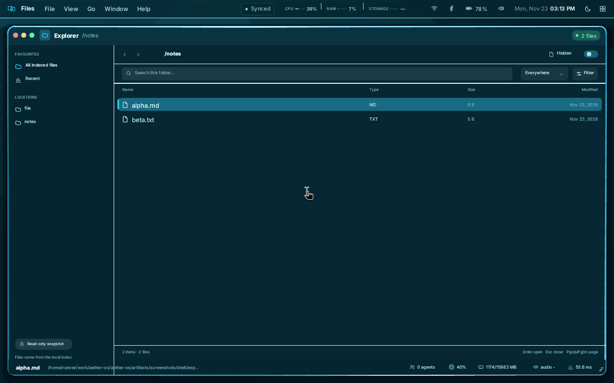
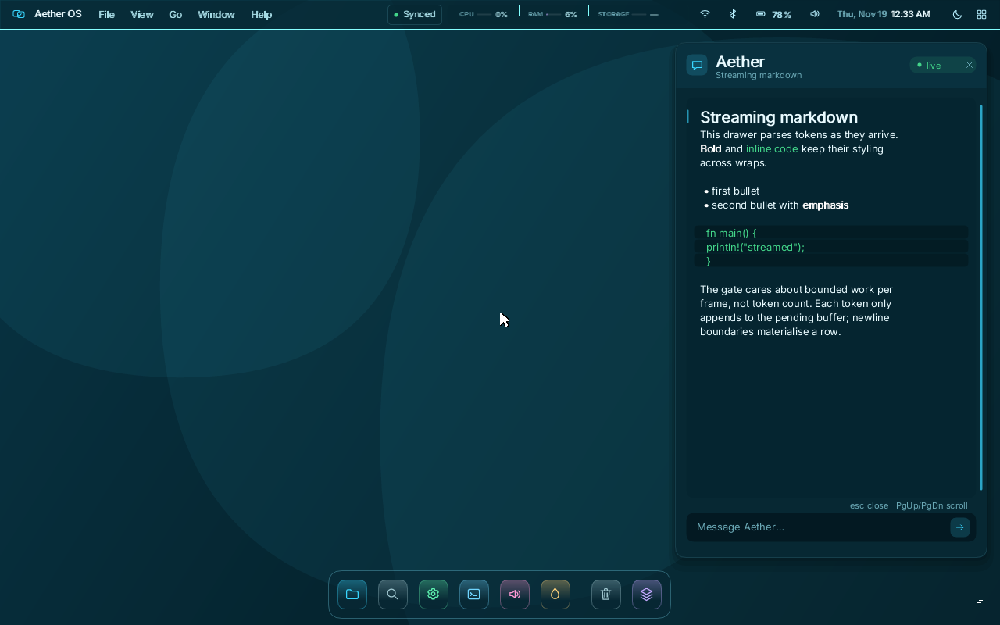
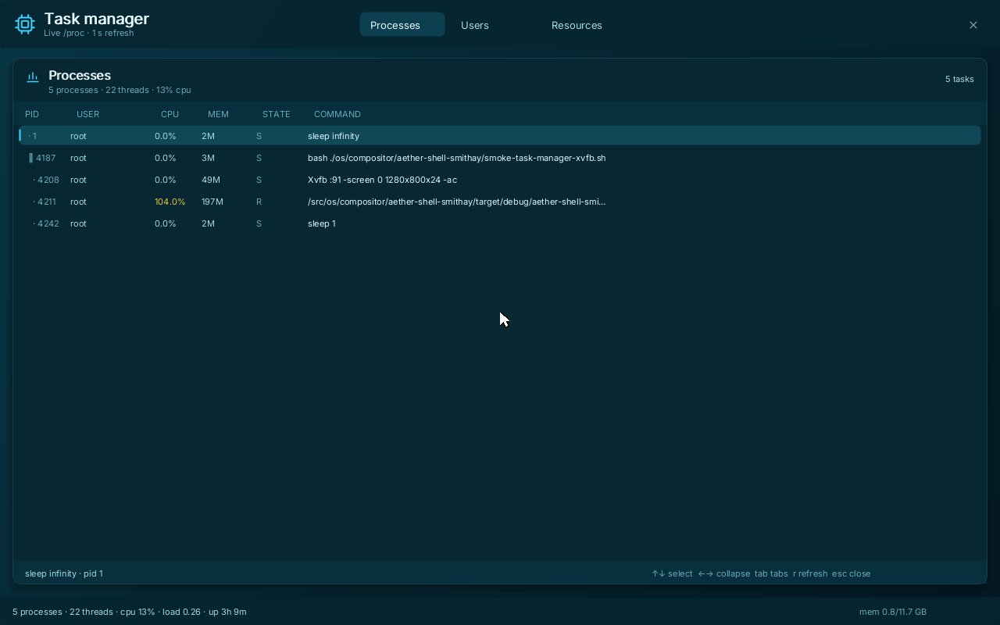
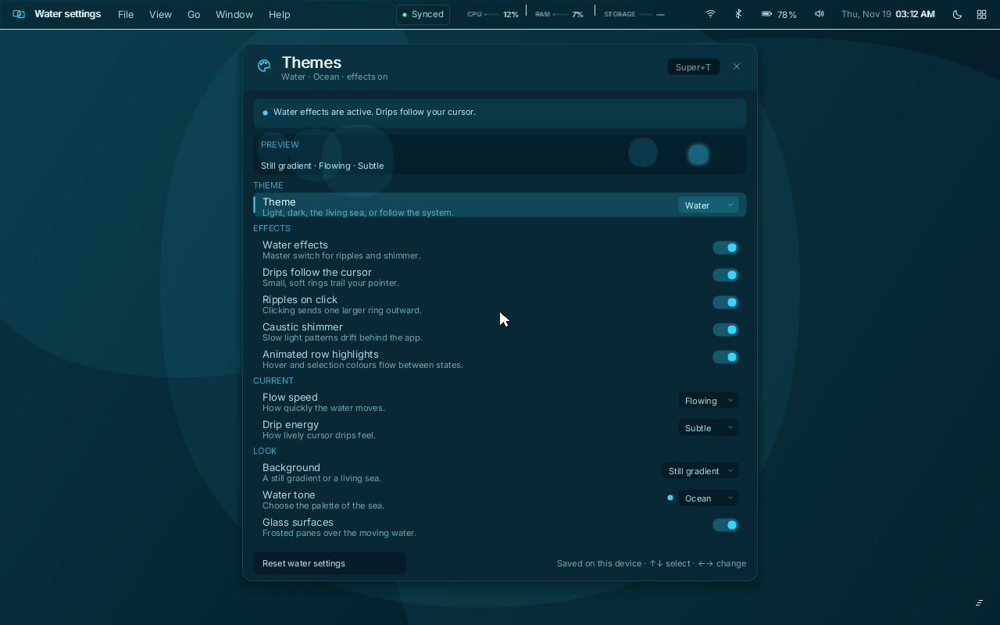
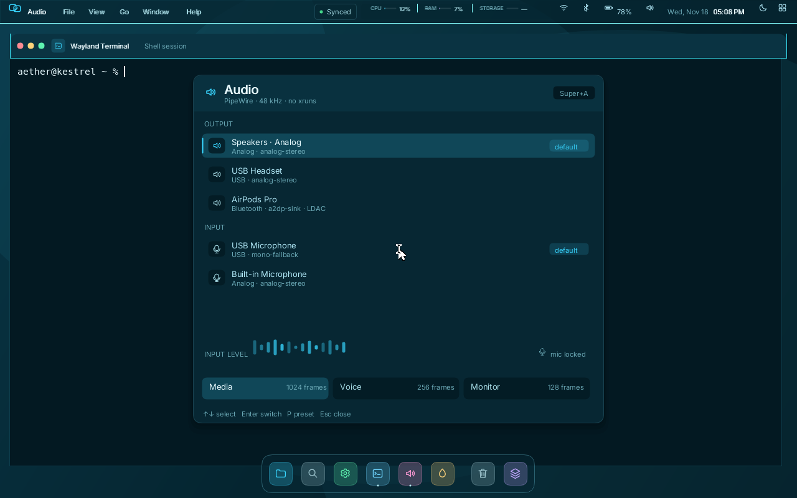
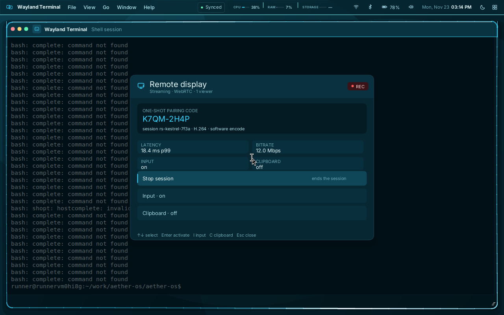
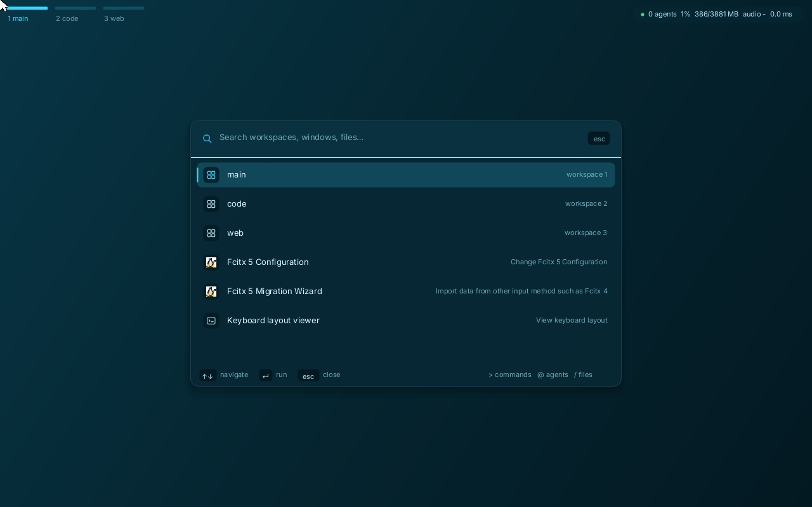
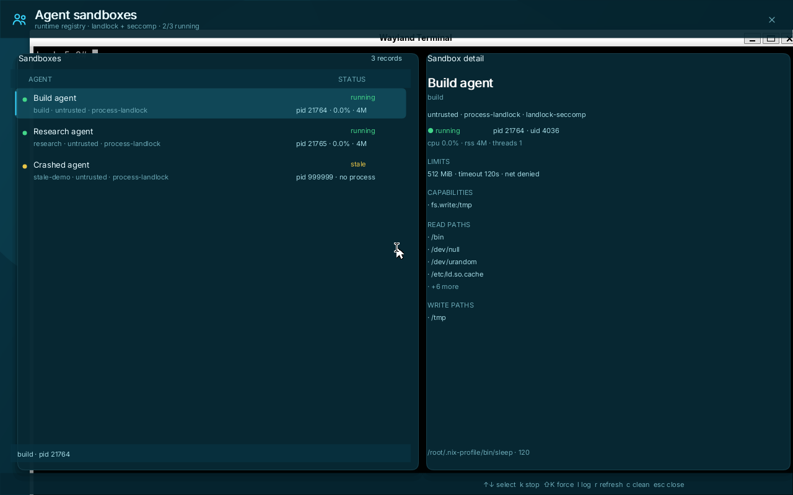

# Aether OS

[](https://github.com/403access/aether-os/actions/workflows/ci.yml)
[](LICENSE)


A **single-target Linux workstation OS** built for exactly one machine: an Intel
Core i7-7700K (Kaby Lake, 4c/8t). Every subsystem is chosen for deterministic
latency and a small resident footprint, then compiled for this CPU. No
portability layer, no generic desktop environment, no telemetry.

The thesis is **one fast surface**: a Rust compositor that renders the window
manager, command palette, AI chat and system chrome in a single scene graph,
backed by an in-memory index that answers in single-digit milliseconds.



## Screenshots

| | |
|:--:|:--:|
| <br>**Indexed explorer** — search hits the index, not the filesystem | <br>**Streaming chat** — markdown and tool calls, bounded per frame |
| <br>**Task manager** — process tree, per-UID totals, resource bars | <br>**Themes** — Water effects, flow, tone and glass, applied live |
| <br>**Audio** — outputs, inputs, presets and a live meter | <br>**Remote display** — one-shot pairing, WebRTC, live HUD |

More surface-by-surface evidence, including the keymap cheatsheet and window
management: [`architecture/smithay-backend.md`](apps/docs/docs/architecture/smithay-backend.md).

Regenerate every capture with `bun run screenshots`. The flow runs the compositor
smokes under Xvfb (inside a Linux container on macOS), drives the assembled site
with Playwright, publishes the curated images and writes
`artifacts/screenshots/index.html` plus a manifest. See
[`scripts/screenshots/README.md`](scripts/screenshots/README.md).

## What exists today

This repository is the **installable base release (v0.1 “Kestrel”)**: the product
surfaces, libraries, indexing engine, IPC protocol, capability model, bootable
NixOS system, live installer ISO and install path are real, tested code.

| Layer | What is in the repo | State |
| --- | --- | --- |
| **Shell** | Compositor core, Smithay and native DRM backends, menu bar, dock, palette, explorer, chat, calendar, task manager, themes, audio, agent sandboxes, remote overlay; window management, clipboard, text input, cursors, damage tracking | ✅ Built; 10k palette p95 1.11 ms, explorer scroll p95 0.004 ms |
| **Services** | `aether-index` (inotify + socket queries), `aether-mcp` (13 audited tools), `aether-chat` model loop, `aether-remote` (H.264/WebRTC), `aether-sandbox` (Landlock + seccomp + per-agent UID) | ✅ Built and screenshot-tested |
| **Libraries** | Domain protocol, BM25F/fuzzy/prefix indexer, SPSC rings + capabilities, agent policy, palette state machine, React UI kit, remote client, benchmark gate | ✅ Unit-tested and typechecked |
| **Web** | Marketing site with the live palette and explorer, documentation site, live browser remote viewer | ✅ Built; Playwright e2e suite, live host pairing |
| **OS** | NixOS flake with the custom 7700K kernel, disko layout, install script, live installer ISO, aarch64 development VM | ✅ `nix flake check` evaluates; hardware boot not in CI |
| **Remaining** | P5 agent supervisor and red-team, reference-hardware latency/RAM gates, compositor DMA-BUF import | 🚧 [Roadmap](apps/docs/docs/roadmap/roadmap.md) |

> **On numbers:** the docs distinguish *measured*, *budgeted*, and *speculative*
> figures. Idle-RAM and latency numbers elsewhere are **budgets and targets**, not
> results — see [`claims-and-evidence.md`](apps/docs/docs/reference/claims-and-evidence.md).

## Quickstart

Requires [Bun](https://bun.sh) ≥ 1.3 and Rust 1.99.1 (pinned in
`rust-toolchain.toml`). Node 26 is optional for tooling that insists on Node; Bun
runs installs, builds and tests.

```bash
bun install
bun run dev:web          # marketing site  → http://localhost:4321
bun run dev:docs         # documentation   → http://localhost:4322/docs/
# live remote viewer (with `aether-remote serve` on 127.0.0.1:7443)
# http://localhost:4321/viewer.html?code=K7QM2H4P

bun run verify           # typecheck + unit tests + design parity + build
bun run test:e2e         # Playwright against the assembled build
bun run os:test          # Rust compositor/shell/audio/sandbox workspace tests
bun run bench:check      # benchmark suite with regression gate
bun run build            # one deployable tree in apps/web/dist
```

Daily-use manual and global hotkeys:
[`using-aether.md`](apps/docs/docs/getting-started/using-aether.md). Inside the
compositor, `Super+/` opens the same cheatsheet.

`bun run build` produces one artifact: the marketing site at `/` and the docs at
`/docs/` — exactly what the GitHub Pages workflow publishes.

## Install on the reference machine

Aether installs from a current NixOS minimal ISO or the included installer ISO.
The target must be UEFI x86_64, and **the whole target disk is wiped**.

```bash
# on a live NixOS ISO, in a clone of this repo:
#   edit os/nixos/disk.nix and set your NVMe device
sudo ./scripts/install.sh /dev/nvme0n1
```

Then reboot and sign in as `oliver` (initial password `aether`).

- [Install guide](apps/docs/docs/getting-started/install.md) — firmware settings, disko commands, recovery
- [First boot checklist](apps/docs/docs/getting-started/first-boot.md)
- [Hardware notes](apps/docs/docs/getting-started/hardware.md)

Build the live installer ISO (x86_64 Linux host with Nix):

```bash
nix build .#iso
```

## Boot it in a VM

`os/vm` is a deliberately separate aarch64 development target: no 7700K kernel,
no XFS layout, no PipeWire, no daemons. It is a harness, not a supported install.

```bash
./scripts/vm-build.sh     # builds aarch64 qcow2 via OrbStack + Nix
./scripts/vm-run.sh       # QEMU/HVF, login aether / aether
./scripts/vm-smoke.sh     # headless boot check
```



See [`virtual-machine.md`](apps/docs/docs/getting-started/virtual-machine.md).

## Architecture

```text
aether-shell    compositor · scene graph · palette · chat · chrome   (Rust/GLES)
──────────────────────────────────────────────────────────────────────────────
aether-index    inotify daemon · socket queries · event ring
aether-mcp      audited system tools  ←  aether-chat model loop
aether-ipc      memfd-style SPSC rings · capability table
──────────────────────────────────────────────────────────────────────────────
PipeWire/WirePlumber · XFS root · NixOS + custom i7-7700K kernel
```

Agents are untrusted by default: Kaby Lake has no PKU, so isolation is Landlock,
seccomp, a dedicated UID, rlimits and an optional cgroup — never a promise.



Start with the [architecture overview](apps/docs/docs/architecture/overview.md),
then the [hardware dossier](apps/docs/docs/architecture/hardware-target.md) and
[agent isolation without PKU](apps/docs/docs/architecture/agent-isolation.md).

### Design commitments

1. **Single target.** `-C target-cpu=native`, `localmodconfig`, hardware facts in
   config. Portability is a non-goal, not an accident.
2. **No idle tax.** No background indexer polling, no Electron, no Qt/GTK runtime
   in the shell. Idle budget: **≤ 200 MB RAM, < 0.5% CPU**.
3. **Explicit trust.** Agents collaborate only through capability-gated shared
   memory, and every system tool call is audited.
4. **Measured, not asserted.** Every performance claim has a benchmark, a budget
   and a CI gate — or is labelled speculative.
5. **Legible.** Every architectural choice has an ADR; every subsystem has a spec
   with non-goals and failure modes.

## Repository layout

```text
apps/web               marketing site, live palette + explorer demo (Vite + React)
apps/docs              Docusaurus: architecture, PRD, roadmap, ADRs, ops
apps/indexer-service   Bun service exposing the TS indexer over a Unix socket
packages/protocol      shared domain types + runtime validation
packages/indexer       tokenizer, inverted index, BM25, fuzzy + prefix search
packages/ipc           memfd-style SPSC ring buffer + capability table
packages/agents        isolation tiers, admission control, collaboration bus
packages/palette       headless command-palette state machine
packages/ui            React design system (palette, chat, chrome)
packages/design-system vendored Water tokens and component primitives
packages/remote        browser remote client (WebCodecs, HTTP/WebRTC transport, input batching)
packages/bench         benchmark runner + regression gate (--check)
os/nixos               reference target: kernel, hardware, disko, installer, services
os/vm                  separate aarch64 development VM target
os/live                live ISO configuration
os/index               system index daemon
os/compositor          Rust workspace: compositor crates and shell backends
scripts                assemble, publish, install, verify helpers
e2e                    Playwright specs for web + docs
.github/workflows      CI, Pages deploy, perf and Nix gates
```

## Documentation

Start at [`intro.md`](apps/docs/docs/intro.md), or run the docs site.

- [Using Aether](apps/docs/docs/getting-started/using-aether.md) — daily manual and keymap
- [Product requirements](apps/docs/docs/product/prd.md) — scope, non-goals, personas
- [Architecture overview](apps/docs/docs/architecture/overview.md)
- [System MCP and the chat trust boundary](apps/docs/docs/architecture/system-mcp.md)
- [Roadmap](apps/docs/docs/roadmap/roadmap.md)
- [Design system and explorer](apps/docs/docs/roadmap/design-system-and-explorer.md) — provenance from the Data Cloud Compare project
- [Build, release and rollback](apps/docs/docs/ops/build-and-release.md) — CI stages, Pages assembly, publishing
- [ADRs](apps/docs/docs/adr/index.md) — one record per architectural decision

## Contributing

```bash
bun run verify           # must pass before a PR
bun run os:test          # Rust workspace tests
bun run test:e2e         # assembled-build browser tests
```

Development setup and conventions: [`contributing/development.md`](apps/docs/docs/contributing/development.md).
Testing strategy: [`contributing/testing.md`](apps/docs/docs/contributing/testing.md).

## License

MIT © Aether OS contributors.
