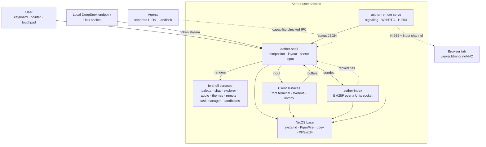
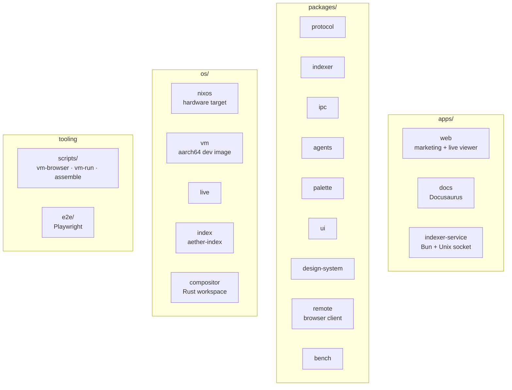
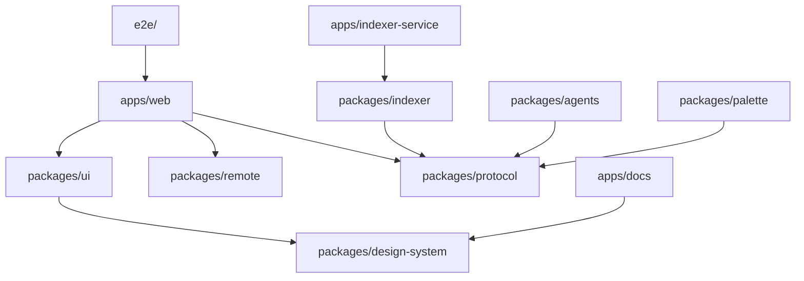
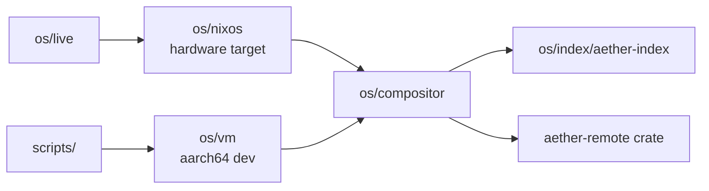
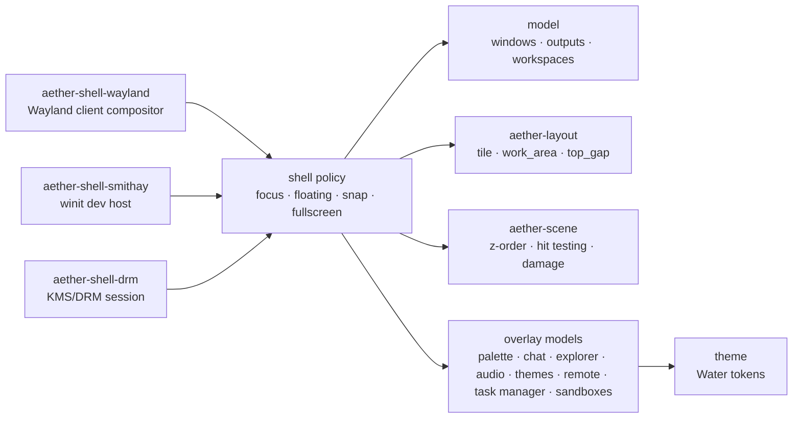
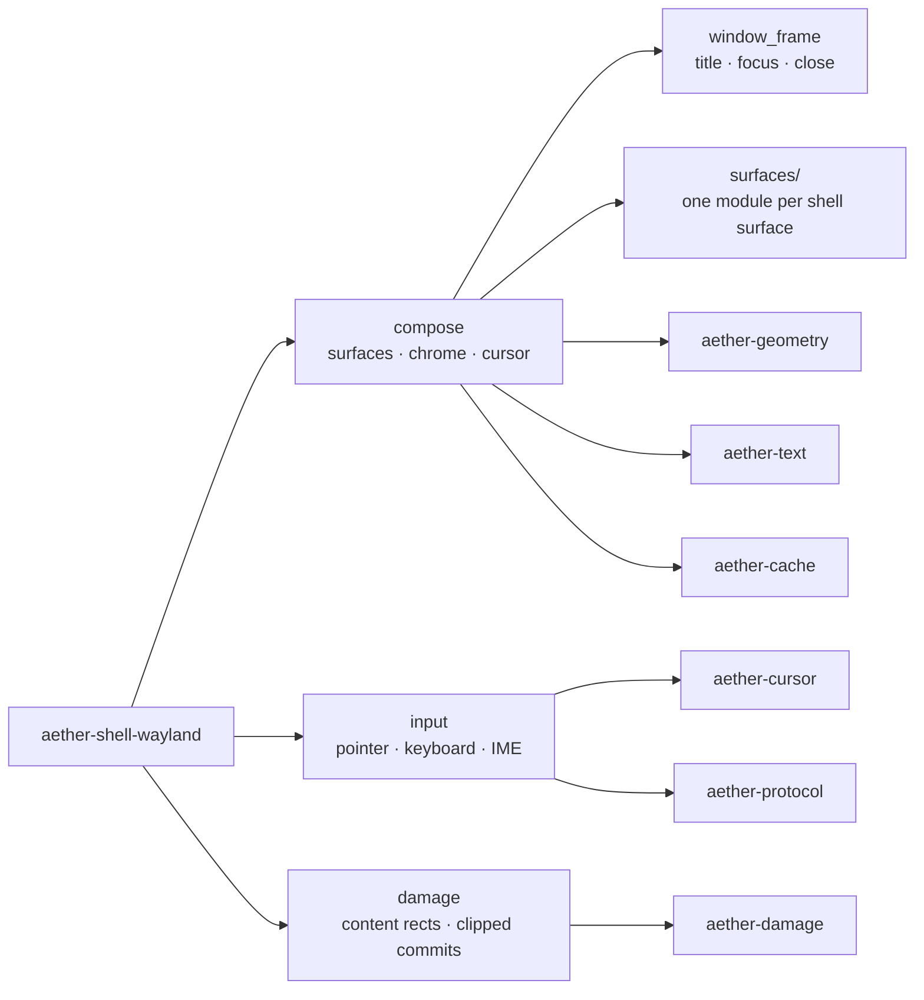
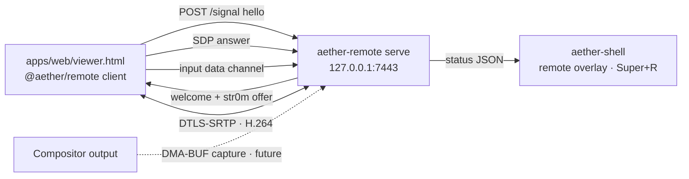
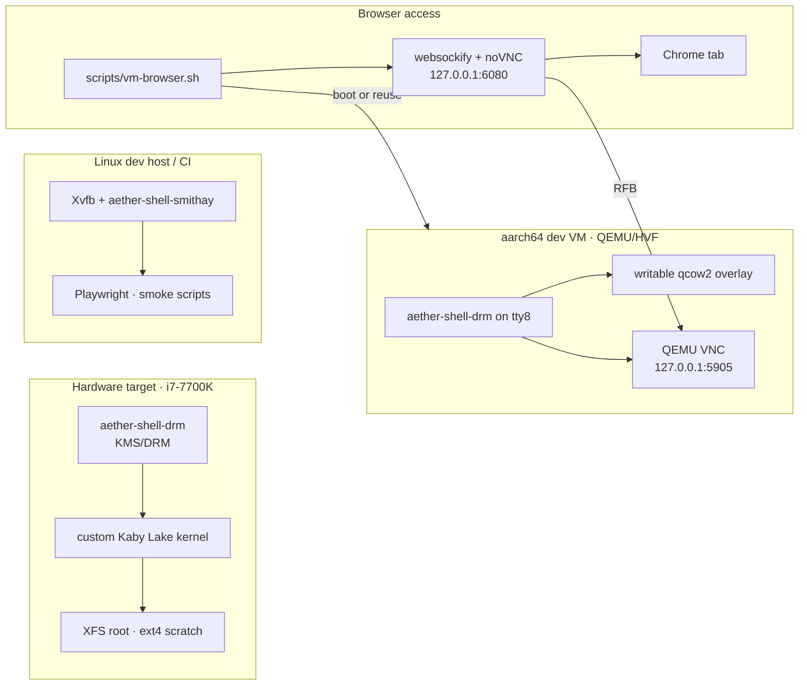

# System diagrams

These are the maintained maps of Aether OS. The diagrams are Mermaid source, so
they render on this page and stay reviewable in the repository. Prose and
evidence for each subsystem live in the linked pages; this page is the visual
index.

- [Architecture overview](/architecture/overview) — the four-layer model, process
  table and trust boundaries in prose.
- [Remote display](/architecture/remote-display) — the detailed connection map,
  pairing sequence and media/input path.
- [Smithay backend](/architecture/smithay-backend) — the Wayland client
  compositor, server-side window frames and input routing.
- [Development VM](/getting-started/virtual-machine#browser-access) — the noVNC
  bridge that puts the VM desktop in a browser.

## Runtime topology

What runs in a session, and what crosses its boundaries.



First-party surfaces are shell layers in the compositor process, not external
clients. External windows are Wayland clients (foot, WebKit, libmpv) wrapped in
the compositor-drawn title bar. `aetherd`, the capability broker, is planned;
today the index and sandbox services are the session-level daemons.

## Repository map

Where each piece lives and what it depends on.

### Where things live



### Web and package flow



`packages/ipc` and `packages/bench` are supporting libraries (ring buffer and
benchmark gate); they do not sit on the UI path shown here.

### OS flow



## Compositor and backends

One backend-neutral shell and three entry points, followed by the Wayland
render/input path that turns shell state into a frame.

### Shell core and backends



### Wayland render and input path



The remaining shared crates are small and single-purpose:

| Crate | Role |
| --- | --- |
| `aether-pacing` | Frame pacing and present timing |
| `aether-preview` | Software renderer for a `FramePlan` (preview binary, docs) |
| `aether-files`, `aether-desktop` | Palette file and desktop-entry providers |
| `aether-audio` | PipeWire route model shared by the CLI, overlay and tests |
| `aether-system` | `/proc` sampler for the task manager |
| `aether-chat` | Chat token stream parsing and markdown segmentation |
| `aether-mcp` | Model Context Protocol server |
| `aether-sandbox` | Kernel-enforced agent sandbox (Landlock/seccomp/UID) |
| `aether-protocol` | Wire types shared by the shell and local services |

The Wayland backend is the product compositor. The Smithay winit adapter is a
development/CI host that runs the same shell and client handling under
Xvfb. The DRM backend owns the real KMS session on the hardware target and the
VM. Render modules (`compose`, `window_frame`, `surfaces`) live in the Wayland
crate because that crate also owns the shared composition path used by the DRM
backend.

## Remote connection at a glance

The browser talks to `aether-remote serve` over two channels: HTTP signaling for
pairing and WebRTC for media plus input. The detailed map, sequence and data
path are on [remote display](/architecture/remote-display#connection-map).



## Deployment targets

The same shell state runs on three bodies, and the browser bridge is a fourth
way to look at it.



## How to change these diagrams

Edit the Mermaid block in this page or in
[remote display](/architecture/remote-display), then build the docs:

```bash
bun run --cwd apps/docs build
```

Keep node names stable and labels short; link to the owning page for detail
instead of duplicating component behaviour here.